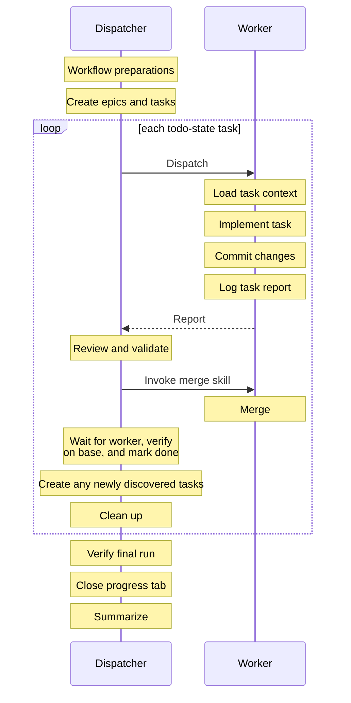

# Multi-Agent Task Workflow using Aven and Workmux

You are the dispatcher. Use Aven to track tasks; Use Workmux to manage workers in separate worktrees. This skill’s instructions take precedence over any successive loaded skills.



## Workflow preparations

### Skills

Load the required skills as needed throughout the workflow.

- **aven** — task management.
- **coordinator** — agent dispatch, monitoring, review, and merging.
- **workmux** — worktree and agent management.
- **worktree** — worktree task delegation.
- **merge** — worker-side commit, rebase, and merge.

### Herdr Multiplexer

This workflow uses Herdr, not tmux. Omit `--parent-session` and ignore any tmux session-selection and window-placement instructions.

### Creating and accessing the Aven tasks DB

Qualify all Aven commands with the `--db` option. As dispatch, your personal Aven commands must use `--db .aven/tasks.db`. Your instructions to unsandboxed macOS workers must also use `--db .aven/tasks.db`. But your instructions to sandboxed Linux workers must use `--db /tmp/.aven/tasks.db`.

When setting status with `aven --db .aven/tasks.db edit`, include `--agent <agent>` (for example, `--agent pi`) while in `active` state, otherwise include `--clear-agent`.

### Miscellaneous

If no git repository exists, initialize one using `git init` and add a .gitignore as an initial commit.

Create an aven project using the root folder name for <project>. Run `aven --db .aven/tasks.db project create <project> --path .`

Open a `tasks` tab by running `sh "<skill-dir>/scripts/open-tasks-tab.sh"` from the project root.

## 1. Create tasks

### 2. Select ready tasks

Create tasks for discovered work, each with scope and acceptance criteria. Exclude deferred work from the current run.

1. Ensure any missing prerequisites are recorded in Aven before scheduling any task.
2. Select tasks with `aven --db .aven/tasks.db list --ready` and applicable filters; inspect each with `aven --db .aven/tasks.db context <task-ref>`. Mark prerequisites `done` only after [Verify and complete the task](#5-verify-and-complete-the-task).
3. Mark the task `active` when starting it.

### 3. Prepare and dispatch a worker

1. Start from the chosen base branch with merged prerequisites.
2. Before worktree reuse, preserve unrelated changes separately and update the task branch with the latest base. The merge skill stages all changes.
3. Use the coordinator workflow to create or reuse the task's worktree.
4. Add a `DISPATCH` note using the [Task note format](#task-note-format), including execution mode and configuration path.
5. Prepare the worker prompt following [Worker brief](#worker-brief).

#### Creating workers

As dispatch, you create workers using `workmux add --config <config file>`. Default to Linux sandbox workers using the config file: `~/.config/workmux/agents.linux.yaml`. If the user explicitly excludes sandboxing or explicitly requests macOS workers, then use `~/.config/workmux/agents.macos.yaml`.

Do not use workmux's `--agent` option.

Even for parallel workers, serialize `workmux add` and `workmux open` per repository to avoid Git/Workmux metadata contention. Preserve prompt-file preparation and startup checks.

On a lock error, pause dispatch. Never delete a potentially live lock. First, inspect owning processes, `workmux list`, and `git worktree list` before retrying. Preserve existing work, reconcile partial resources, and remove only resources confirmed safe to discard.

If startup confirmation fails, inspect `workmux status` and `workmux capture <handle>` for each unconfirmed worker before retrying or monitoring completion. Preserve unfinished work under [Recovery and handoff](#recovery-and-handoff).

#### Worker brief

1. Include the assigned Aven task reference, base branch, and the worker instructions below in each worker prompt.
2. Supply the task-context command for the worker's execution mode, replacing `<task-ref>` with the assigned task reference: Linux sandbox uses `aven --db /tmp/.aven/tasks.db context <task-ref>`; unsandboxed macOS uses `aven --db .aven/tasks.db context <task-ref>`.
3. Provide further instructions if needed, but do not replicate what is already in the task.
4. Instruct the worker to wait for explicit merge authorization from dispatch. Once authorized, run `workmux merge` without `--notification`, overriding the merge skill's notification instructions; dispatch handles user notification.
5. Instruct the worker to check the supplied database exists, then retrieve and read the task context using the supplied command. Never initialize a worker database.
6. Instruct the worker to implement the task, verify acceptance criteria, and commit.
7. Instruct the worker to report only to dispatch: a concise implementation summary, notable decisions, affected components, check results, commit IDs, blockers, and discovered work.

### 4. Review and merge the result

1. Follow coordinator review.
2. Validate the worker report against Git state and `aven --db .aven/tasks.db show <task-ref>`.
3. Keep the report provisional until merged-work verification passes. Workmux `done` does not complete the Aven task.
4. Follow coordinator merging with the [Pi merge command](#pi-merge-command) override. Include the worker brief's notification override in every worker merge request.

#### Pi merge command

Pi uses `/skill:<name>`; trailing arguments become a user request, not `$ARGUMENTS` substitutions. The merge target comes from the branch's `workmux-base` Git config.

Before merging, check it against the task's recorded base:

```sh
branch=$(git branch --show-current)
configured_base=$(git config --local --get "branch.$branch.workmux-base")
test "$configured_base" = "<recorded-base>"
```

Stop if the base is missing or mismatched. Otherwise, replace the coordinator's `/merge` with `/skill:merge --keep` to retain the worktree until verification passes.

### 5. Verify and complete the task

1. Confirm the merge reached the base branch; run required checks on that revision.
2. If checks fail or cannot run, keep the task `active` and retain its worktree. Return actionable failures to the worker for repair, review and merge the fix, then repeat verification on the updated base revision. If blocked, record the merge, check results, blocker, and next action in Aven; report the blocker to the user.
3. Once acceptance criteria and checks pass, retain the Git-verified merged revision and check results for the completion comment. Do not repeat the worker report.
4. Mark the task `done`, then query `aven --db .aven/tasks.db list --ready` with the run's filters for newly eligible tasks.
5. Clean up the task's worktree and branch; add one `MERGE` completion comment in Aven containing the merged revision, check results, and closure: `Verified and done. Cleanup complete.` If cleanup fails, record pending cleanup and the next action without claiming closure.

### 6. Complete the run

1. Confirm all selected tasks are verified and merged.
2. Run run-wide checks on the final base revision; require passing results.
3. Confirm cleanup is complete.
4. If any condition is unmet, record a handoff under [Recovery and handoff](#recovery-and-handoff) and leave the task progress tab open.
5. Otherwise, close the run-owned task progress tab before the final response using `sh "<skill-dir>/scripts/close-tasks-tab.sh"`.

### Recovery and handoff

#### Interrupted work

After context loss or worker exit, run `aven --db .aven/tasks.db list --open` and inspect each task with `aven --db .aven/tasks.db context <task-ref>`. Before restarting, check Workmux and Git using handles and branches from Aven notes; resolve ownership or merge-record conflicts.

#### Pending cleanup

Finish pending cleanup for `done` tasks without merging again.

#### Reassignment

Before reassignment, stop the previous worker, preserve its changes, check whether it merged, and record the handoff.

#### Unfinished tasks

Record progress, check results, blockers, and next actions in Aven. Retain unfinished worktrees, overriding coordinator cleanup.

#### Task note format

Use these prefixes for dispatch-written Aven notes and comments. They are note templates, not shell commands. These rules override more verbose administrative reporting in the required skills.

- Keep administrative entries to one line per event. Record only actual transitions; do not narrate routine commands, polling, or repeat unchanged metadata.
- Keep agent activity and results substantive and concise: state the key change or finding and its evidence. Include decisions or failures only when they affect the outcome. Do not reproduce the full worker report.
- Reference earlier dispatch metadata rather than repeating it. Record changed handles, branches, or execution modes explicitly.
- Report observed facts only; worker claims remain provisional until verified.
- Reference the Git-verified starting revision in `DISPATCH`, the worker commit in `RESULT`, and the verified base revision in `MERGE`. Use Git short-form SHAs for all revision references in notes and comments, including `SUMMARY`, generated with `git rev-parse --short <revision>` so the abbreviation is unambiguous in the repository. Check each reference against Git; do not use a branch name alone as the revision record.

##### Templates

```text
DISPATCH: <agent> started in <handle> on <task-branch> at <starting-revision-short-SHA>, based on <base>. <Linux|macOS> worker using <config-path>.
ACTIVITY: <key progress>. <Significant decision and reason, if needed>.
RESULT: <key change or finding> in commit <commit-short-SHA>. <Decisive check result>. Awaiting merge verification.
MERGE: Merged into <base> at <revision-short-SHA>. <Check results>. Verified and done. Cleanup complete.
BLOCKED: <blocker>. Work retained in <worktree/branch>. <Owner> to <next action>.
SUMMARY: <delivered outcome>. <Acceptance evidence and final checks> at <revision-short-SHA>. <Follow-up work, if any>.
```

Write each event as a separate note in plain sentences, not a list of key-value fields. Display paths under the user's home directory with `~` in notes. Omit the task reference when the note is attached to that task; include it in shared or run-level notes. Omit optional details when irrelevant; do not fill notes with empty placeholders. `ACTIVITY` is for meaningful developments, not heartbeat updates. `RESULT` records a substantive, concise worker outcome once, not a full report; validate it without copying it into the completion comment. Include closure in the `MERGE` completion comment only after verification, Aven status `done`, and cleanup are complete; do not emit a separate `CLOSED` entry. If cleanup is pending or verification fails, record the verified facts and next action without claiming closure. Use `SUMMARY` once at run completion; an unfinished run needs a handoff, not a closure claim.
